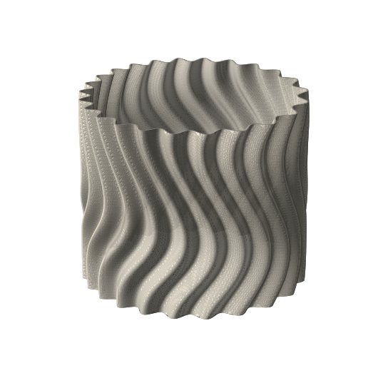

# Lamp diffuser

A diffuser for a spherical lamp: a tube 150 mm tall with a 1 mm wall,
open at both ends. Its wall
ripples in 24 soft flutes that lean one way, then the other, up the
height, and the lean rolls once round the lamp, so the flutes on one side
sway left while those opposite sway right.



Stand it over the lamp; the cord runs out under the bottom rim, which
may rock on it a little.

## Shape

The wall's outer face is 170 mm across before the ripple; the flutes stand
4.5 mm in and out of that, so it is 161 to 179 mm across, inside the
±10 mm allowed. The inside is at least 159 mm clear.

```
r(theta, z) = d / 2 + ripple_a * cos(lobes * (theta - s(theta, z) / (d / 2)))
s(theta, z) = sway * sin(2 pi * sway_periods * z / h + sway_turns * theta)
```

`s` is how far a flute is pushed sideways round the rim: up to 16 mm,
once back and forth up the height. With `--sway_turns 0` every flute
leans together; with `--sway 0` they run straight up.

The wall is 1 mm thick measured level across it: in every horizontal
section the inner face is the outer one offset 1 mm inward. Where the
flutes lean the wall is a little thinner measured square to the face, down
to about 0.86 mm where they lean most.

## Dimensions

| | default | flag |
|---|---|---|
| diameter of the outer face, before the ripple | 170 mm | `--d` |
| height | 150 mm | `--h` |
| wall | 1 mm, level across | `--wall` |
| flutes | 24, about 22 mm apart | `--lobes` |
| flute depth | 4.5 mm in and out | `--ripple_a` |
| sideways sway | 16 mm | `--sway` |
| sways up the height | 1 | `--sway_periods` |
| turns of the sway round the rim | 1 | `--sway_turns` |

`validate()` refuses a ripple wider than ±10 mm across, flutes leaning
more than 45 degrees from vertical (the default leans at most 31), crests
curved tighter than the wall is thick (they are R2.1 or more), and
sways shorter than 20 mm up the height (too short for the
sections to follow), and anything over the 256 mm bed.

## Use

```
pixi run diffuser    # stl/diffuser_d170_h150_l24_a4.5_s16.stl
pixi run render out.stl --lobes 18 --sway 10
pixi run preview     # preview.png
pixi run test
```

Print it as modeled, either rim on the bed. It suits vase mode (spiral,
one perimeter, a 1 mm line, no bottom layers), which leaves no seam;
with a 0.4 mm nozzle a single 1 mm perimeter may need a wider nozzle or
two perimeters instead. Nothing overhangs more than 31 degrees, so
nothing needs support. It stands on the bed on just its 1 mm rim, so
print it with a brim. A light, translucent filament diffuses best. It is
about 106 cm³ of plastic, about 131 g of PLA.

## How it is built

Each face of the wall is one B-spline surface. Level sections every
1.25 mm are fitted with periodic cubic splines through 48 points per
flute, all parameterized by angle so they share their knots; then a cubic
spline is fitted up through each column of the sections' poles. The
surface passes exactly through every section and strays at most 0.003 mm
from `r(theta, z)` between them. OCCT's loft was tried first: it fits one
high-degree surface through all the sections and rang near its ends,
0.14 mm off on the inner face. The inside is built the same way, from
past one end to past the other, and cut out.

The tests check the outer face against `r(theta, z)` and the wall's
thickness, including just inside each rim; that the tube is open end
to end; the volume against the sections' areas; and the lean of every face
over its whole parameter range.
