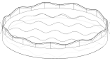

# Plant pot base

Round bases for plant pots: a floor and a 2.4 mm wall, whose top edge
rises and falls in gentle waves round the rim. There are two:

- a 7 cm base with a flat 2 mm floor and six waves (`pixi run base`), and
- a 15 cm base whose floor rises and falls in rounded bumps, so the pot
  rests on their tops and water stands in the hollows between, where air
  reaches it and it dries (`pixi run base-15`). See [The 15 cm base](#the-15-cm-base).


The pot's sides slope outward, which is not modeled. Instead the pocket is
5 mm wider than the pot's foot, so the pot drops in without catching on the
wall.

The crest follows a raised cosine round the rim:

```
z(theta) = trough_h + (peak_h - trough_h) * (1 + cos(lobes * theta)) / 2
```

At the defaults it peaks at 10 mm and dips to 6 mm, both measured from the
bed, over six lobes about 42 mm long. In every radial section the crest is
level across the wall, with both corners rounded to R1, so the rounding
looks the same on the steep parts of the wave as on the peaks.

## Dimensions

| | default | flag |
|---|---|---|
| pot diameter at the foot | 70 mm | `--pot_d` |
| slack | 5 mm, so the pocket is 75 mm across | `--slack` |
| wall | 2.4 mm, so the base is 79.8 mm across | `--wall` |
| floor | 2 mm | `--floor` |
| wave peaks | 10 mm from the bed | `--peak_h` |
| wave troughs | 6 mm from the bed | `--trough_h` |
| lobes | 6 | `--lobes` |
| crest rounding | R1 on both corners | `--crest_r` |
| foot chamfer | 0.5 mm on the outer edge, against elephant's foot | `--foot_chamfer` |
| floor ripple amplitude | 0, a flat floor | `--ripple_a` |
| floor ripple wavelength | 40 mm | `--ripple_l` |
| floor ripple fade | 0, no fade | `--ripple_fade` |

`validate()` refuses a trough too low for the crest rounding to fit above
the floor (the ripples' peaks, if any), rounding wider than half the wall,
and anything over the 256 mm bed.

## The 15 cm base



150 mm across and 25 mm tall: the same base with a 145.2 mm pocket
(`--pot_d 140.2 --slack 5`), a wall waving between 21 and 25 mm over 11
lobes about 43 mm long, and a rippled floor:

```
z(x, y) = floor + ripple_a * (1 + e(r) * sin(k x) * cos(k y)),   k = 2 pi / ripple_l
```

With `ripple_a` 5 mm and `ripple_l` 33.3 mm, the floor is 2 mm thick at
the bottom of the hollows and 12 mm on top of the bumps, whose tops are
23.6 mm from their nearest neighbors; the axis is halfway up a slope. The
envelope `e(r)` is 1 in the middle and falls smoothly to 0 over the last
15 mm before the wall (`--ripple_fade 15`), so the floor meets the wall
level, 7 mm high all round, with no slope at the corner. That leaves 19
bumps at full height for the pot to stand on, plus some partly faded ones
near the wall, and as many hollows. The pot stands 13 mm into the wall at
the wall's highest points, 9 mm at its lowest.

The slopes are at most about 43 degrees, smooth, with no sharp ridges or
narrow pits, and the corner with the wall is the same all round, so a
sponge or brush can wipe the whole floor. The slopes face up, so the base
prints without support. A longer `--ripple_l` gives fewer, gentler bumps.

The base is about 141 cm³ if printed solid; most of that is the floor,
so the slicer's infill sets how much plastic it takes.
A line drawing shows the bumps only by their silhouettes, the wavy curves
across the floor.

## Use

```
pixi run base                       # stl/base_d70_s5_h6-10_l6.stl
pixi run base-15                    # stl/base_d150_h21-25_l11_ripple5x100.stl
pixi run render out.stl --lobes 8 --trough_h 4
pixi run test
```

Print it as modeled, floor on the bed. The wall is vertical and the crest
only ever faces up, so nothing overhangs and nothing needs support. It is
about 13.4 cm³ of plastic.

The floor is solid, so the base also works as a drip tray.

## How it is built

The wall's foot is a plain ring, turned about the axis, from the bed to
midway between the floor's top and the crest's rounding. Above it the wall
is lofted through its cross-section stood up in radial planes, one
half-lobe (peak to trough) at a time; that piece is mirrored and turned
round the rim, and the floor is fused in. A single loft round the whole rim
gave OCCT booleans that returned wrong volumes once the wave had more than
six lobes, so the tests check the base's volume against the analytic value
as well as its heights.

The rippled floor is a B-spline fitted through the ripple on a grid of 20
points per wavelength (or per 2 × the fade, if that is shorter), and a
disc is cut off under it. The fade follows a quintic smoothstep rather
than cos², because the fit missed cos²'s jumps in curvature by up to
0.4 mm. OCCT could not
intersect that B-spline with the lofted wall, so the ring is there to give
the floor a true cylinder to meet. The tests compare the volume against the
analytic value (the ripple is odd in x, so it adds only its mean height),
and integrate the volume more finely than build123d's default, which is
off by about 0.5 % on the B-spline.
